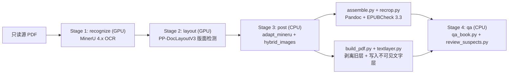

# metagraphe（转写）

> *μεταγραφή (metagraphē)* — 古希腊语“转写、摹录、抄写转译”。


-green)


**metagraphe** 是一套面向**中文扫描版学术著作、人文社科影印书与地方志**的高精度本地 OCR 与出版级多格式交付流水线。它在**零修改原扫描图字节**的前提下，将扫描 PDF 转为**可检索双层 PDF**、**出版级 EPUB 3.3（支持 Apple Books 与微信读书双端原地弹窗脚注）**、**无损重裁插图 Markdown** 与**带页码坐标的结构化 JSON**。

---

## 目录

- [适用场景与边界限制](#适用场景与边界限制)
- [按输入来源选择处理路径](#按输入来源选择处理路径)
- [运行环境与硬件要求](#运行环境与硬件要求)
- [流水线架构](#流水线架构)
- [交付产物与阅读器兼容性](#交付产物与阅读器兼容性)
- [快速开始](#快速开始)
- [常用命令](#常用命令)
- [项目结构](#项目结构)
- [常见问题与排障](#常见问题与排障)
- [致谢](#致谢)

---

## 适用场景与边界限制

> **使用前请先核对以下边界条件**，避免在不适配的文档类型或硬件上浪费时间。

### ✅ 最适用场景
- **中文横排印刷体扫描书**：人文社科专著、历史/哲学论著、地方志（单栏或双栏排版）；
- **含复杂版面元素的学术书**：大量页底脚注（`①–⑳`、`*`、`[1]` 及跨页续注）、整块缩进学术引文、跨页续表、中英混排；
- **自带劣质旧 OCR 层的 PDF**：如超星 `/BHJXID /OCRText` 层、老式 `0 Tr` 图压字隐形层或错位 `3 Tr` 文本层，需干净剥离后重建文字层；
- **个人藏书长期归档**：需要同时保留“原图零损双层 PDF”与“主流阅读器可舒适流式阅读的精排 EPUB”。

### ⚠️ 不适用范围与已知限制（Non-Goals）
- **竖排右翻古籍 / 线装影印本**：当前版面阅读顺序、合段与 `bbox` 对齐规则面向现代横排书籍，竖排古籍未做专门适配；
- **手写体稿本 / 漫画 / 纯画册**：MinerU 与后处理面向印刷体文字书，漫画建议直接保留原图，不建议走本流水线；
- **重度数学公式排版**：行内公式仅清洗为可读 Unicode 文本（去 LaTeX 残留），不面向以复杂多行公式为主的理工科教材；
- **加密 / DRM 保护文件**：需用户自行准备未加密的只读源 PDF，本工具不提供也不支持任何 DRM 绕过；
- **纯 CPU 环境**：仅 `post`（重打包 EPUB / 双层 PDF）、`qa` 以及「已有 OCR `.docx` 直转 EPUB 3」快捷路径可在纯 CPU 下运行；`recognize`（MinerU）与 `layout`（PP-DocLayoutV3）**强依赖 NVIDIA CUDA GPU**。

---

## 按输入来源选择处理路径

开始处理前，先按手头文件的来源类型选择对应路径：

| 输入来源类型 | 典型特征 | 推荐处理路径 | 硬件与耗时 |
| --- | --- | --- | --- |
| **类型 A：纯扫描 PDF / 含劣质旧 OCR 层 PDF**（默认主线） | 仅有扫描版 PDF，或需同时产出“原图零损双层 PDF + 出版级 EPUB 3.3（含双端弹窗脚注）” | `run_all.sh`（MinerU 4.x + PP-DocLayoutV3 → `assemble.py` / `build_pdf.py`） | NVIDIA GPU（约 15–25 分钟/本） |
| **类型 B：已有可用 OCR `.docx`**（纯 CPU 快捷路径） | 目录中已有 ABBYY / WPS / Acrobat 等转出的完整 `.docx`（可选配原扫描 PDF 首页作封面），只需快速生成干净的 EPUB 3.3 | `scripts/docx_to_epub.py`（先 `--inspect` 预检，再直出 EPUB 3.3） | **纯 CPU、零外部 Python 依赖**（数秒完成） |

### 类型 B：OCR `.docx` → EPUB 3.3 使用要点

`scripts/docx_to_epub.py` 针对扫描 PDF 转出的 `.docx` 内置了四项常见清洗逻辑，无需重跑 GPU OCR：
1. **OOXML 重复节点去重**：跳过 `mc:AlternateContent` 中的 `mc:Fallback`，并隔离直接正文 run 与嵌套 `w:txbxContent`，避免文字与插图双份重复；
2. **碎片装饰图过滤**：结合文件体积（默认 `>= 4 KB`）与纯 Python 解析的 PNG/JPEG 像素尺寸（默认短边 `>= 60 px`），过滤 PDF 转换器切出的分隔线/页眉细条，完整保留正文插图与地图；
3. **版面“伪表格”解包**：自动区分真正的数据表（如编委会名单）与图文混排/扉页版面伪表，将伪表解包为普通 `<figure>` + `<p>`，消除多余边框；
4. **扉页艺术字与排版清洗**：自动清理孤立页码、书名页眉及中文字间因 PDF 断行产生的多余空格，提取 CIP 元数据并可选通过 `--cover-pdf` 从原 PDF 首页渲染封面；若书籍章节扉页使用大量艺术字导致 OCR 乱码，可配合 `--chapters chapters.json` 指定目录真值切章。

```bash
# 1. 只读预检：评估已有 .docx 的字数、图片分布、CIP 元数据与候选标题
python3 scripts/docx_to_epub.py --inspect /path/to/book.docx

# 2. 纯 CPU 直出 EPUB 3.3（可选配原扫描 PDF 抽取封面）
python3 scripts/docx_to_epub.py /path/to/book.docx /path/to/book.epub \
  --cover-pdf /path/to/book.pdf

# 3. 验证生成的 EPUB 3.3（如已安装 EPUBCheck）
java -jar /opt/ocr/epubcheck/epubcheck.jar /path/to/book.epub
```

> **提示**：类型 B 面向流式 `.docx`（无可靠页级 `bbox`），不产出双层 PDF；若发现 `.docx` 本身错字严重、缺页或需要“原图零损双层 PDF + 双端弹窗脚注”，请直接走 **类型 A** 主线。

---

## 运行环境与硬件要求

### 1. 硬件建议

| 资源项 | 最低要求 | 推荐配置 | 实测基准环境 |
| --- | --- | --- | --- |
| **GPU** | NVIDIA GPU，8 GB 显存（CUDA 12.x） | NVIDIA GPU，**10–12 GB+ 显存** | RTX 3080 10 GB（433 页学术书：`recognize` 约 20 分钟，`layout` 约 70 秒） |
| **CPU** | 4 核 x86_64 | 8–12 核 x86_64 | AMD Ryzen 9 5900X |
| **内存（RAM）** | 16 GB | **32 GB**（处理千页地方志更稳） | 31 GiB（WSL2） |
| **可用磁盘** | 30 GB+（模型缓存约 15–20 GB） | **100 GB+** | 批量调度在磁盘余量 `< 30 GB` 时自动暂停保护 |

### 2. 操作系统与核心依赖

- **操作系统**：**Linux x86_64**（推荐 Ubuntu 24.04 LTS）或 **Windows 11 + WSL2（Ubuntu 24.04 LTS）**。
  - 暂不支持原生 macOS（Apple Silicon 无 CUDA）或直接在原生 Windows 下运行 GPU OCR 阶段。
- **环境隔离**：为避免 `PyTorch / vLLM`、`PaddlePaddle` 与 PDF/EPUB 后处理依赖冲突，所有 Python 环境通过 `uv` 隔离安装在 `/opt/ocr/{mineru,paddle,post}`。
- **已验证版本快照**（完整锁定见 [scripts/env_versions.lock.json](scripts/env_versions.lock.json)）：
  - **系统工具**：Python `3.12`、`uv`、`Pandoc 3.6.4+`、`OpenJDK 21+`、`EPUBCheck 5.2+`、`fonts-noto-cjk`、`libjpeg-turbo-progs`
  - **OCR 识别环境（`/opt/ocr/mineru`）**：`mineru 4.0.12`（`--tier advanced --ocr-mode ocr`）、`torch`、`vllm`
  - **版面检测环境（`/opt/ocr/paddle`）**：`paddlepaddle-gpu 3.2.1`、`paddleocr 3.7.0`、`paddlex 3.7.2`（PP-DocLayoutV3）
  - **后处理与质检环境（`/opt/ocr/post`）**：`pymupdf`、`pikepdf`、`lxml`、`pillow`、`rapidfuzz`、`numpy`

---

## 流水线架构



| 阶段 | 执行设备 | 核心脚本 | 主要职责 |
| --- | --- | --- | --- |
| **1. `recognize`** | GPU 串行 | `make_pages_json.py` → `run_mineru_full.sh` | 忽略旧文字层，对每页扫描图做全量文字、表格、脚注与标题识别 |
| **2. `layout`** | GPU 串行 | `run_layout_full.sh` → `run_layout.py` | PP-DocLayoutV3 独立版面检测（约 0.14 s/页），补强插图与表格定位 |
| **3. `post`** | CPU 并行 | `adapt_mineru.py` → `hybrid_images.py` → `assemble.py` → `build_pdf.py` | 去 LaTeX 残留、原生分辨率重裁插图、合并跨页段落与续表、生成 EPUB 3 与双层 PDF |
| **4. `qa`** | CPU | `qa_book.py`、`review_suspects.py` | 校验页数、原图 SHA256、旧层残留、`EPUBCheck`、空白页分诊与疑难页 HTML 复核看板 |

---

## 交付产物与阅读器兼容性

每本书输出 4 类产物：
1. **`<书名>_双层.pdf`**：原扫描图字节级零修改（逐页 SHA256 校验一致）；基于 PDF 图形状态栈（`q`/`Q`/`Tr`）与全页不透明图遮挡检测清除旧 OCR 残层（保护真正可见矢量文字），写入精确 `render_mode=3` 检索层与书签。
2. **`<书名>.epub`**：标准 EPUB 3.3（`EPUBCheck` `0 fatals / 0 errors / 0 warnings`）：
   - **三层自适应目录**：地方志按 编/章/节 分级（`--split-level=2`）；普通学术书自动对齐原 PDF 书签并按大章切分（`--split-level=1`），默认去除正文冗余纸书目录页（`--keep-toc-pages` 可保留），且不将 `nav.xhtml` 塞入 `<spine>`，彻底避免微信读书出现 `Guide`/`Pages` 错乱页；
   - **出版级前/后附页**：自动嵌入封面（EPUB 3 `cover-image` + 微信读书 `<meta name="cover">`）、提取 `<dc:creator>` / `<dc:publisher>` / `<dc:date>` / `urn:isbn:...`；封底自动归位至书末，扉页整页图片显示，版权页独立分页且 CIP 与居中版权牌记分区排版；
   - **版面几何还原**：单栏页自动按原 PDF `bbox` 还原居中/右对齐段落，整块缩进引文自动转为 `<blockquote>`（楷体 + 左侧灰线）。
3. **`book.md` + `images/`**：无损重裁插图/表格截图 + 完整 Markdown。
4. **`book.json`**：带 1-based 页码与 `bbox` 坐标的结构化 JSON（不混入 EPUB 专用标记，确保双层 PDF 纯净）。

### 脚注模式与主流阅读器兼容矩阵（`--footnote-mode`）

| 模式 | 正文注标与篇末结构 | Apple Books | 微信读书（本地导入） | 多看 / Kobo | 适用建议 |
| --- | --- | --- | --- | --- | --- |
| **`dual`（默认）** | `<a epub:type="noteref" class="duokan-footnote">` 包裹 `` + 篇末 `<aside epub:type="footnote">` | 原地弹窗 + 自动隐藏篇末注 | 原地弹出黑框气泡（篇末保留参考注，支持全文搜索与划线） | 原地弹窗 / 双向跳转 | **推荐**：单文件全平台通用 |
| **`weread`** | 裸 `` + 篇末纯文本参考注 | 仅显示图标（不弹窗） | 原地弹出黑框气泡 | 不弹窗 | 仅作微信读书排查/专版备选 |
| **`epub3`** | 纯上标 `<a epub:type="noteref"><sup>N</sup></a>` + `<aside epub:type="footnote">` | 原地弹窗 + 自动隐藏篇末注 | 锚点跳转至篇末注释群 | 原地弹窗 / 双向跳转 | 偏好纯数字上标时使用 |

---

## 快速开始

### 1. 克隆仓库

```bash
git clone https://github.com/TunnelofMark/metagraphe.git
cd metagraphe
```

### 2. 在 WSL2 / Linux 中部署隔离环境

`scripts/install_wsl.sh` 会自动安装系统依赖、创建 `/opt/ocr/{mineru,paddle,post}` 三个独立虚拟环境并配置模型缓存路径：

```bash
# 建议以 root 或具备 /opt/ocr 写权限的用户执行
bash scripts/install_wsl.sh
```

> **提示**：首次运行 `recognize` / `layout` 时会自动拉取 MinerU 与 PP-DocLayoutV3 权重（总计约 15 GB），请确保网络畅通且缓存盘空间充足。`EPUBCheck` 默认路径为 `/opt/ocr/epubcheck/epubcheck.jar`。

### 3. 运行离线回归测试验证安装

```bash
/opt/ocr/post/bin/python scripts/test_pipeline_fixes.py
```

---

## 常用命令

```bash
# 1. 源 PDF 只读预检（检查是否纯扫描、是否含旧 OCR 层、页数与分辨率）
/opt/ocr/post/bin/python scripts/inspect_pdf.py /path/to/book.pdf 1-20

# 2. 单书或批量全流程处理（自动断点续跑，磁盘余量 < 30 GB 自动暂停）
bash scripts/run_all.sh --only "<书名stem>"

# 3. 仅重新打包 EPUB（调整脚注模式/样式后秒级重出，无需重跑 GPU OCR）
/opt/ocr/post/bin/python scripts/assemble.py \
  <out_dir>/work/doc_hybrid.json \
  /path/to/book.pdf \
  <out_dir> \
  --title "<书名>" \
  --no-recrop \
  --footnote-mode dual

# 4. 校验生成的 EPUB 3.3 规范合规性
java -jar /opt/ocr/epubcheck/epubcheck.jar <out_dir>/book.epub

# 5. 疑难页自动分诊与可视化 HTML 复核看板（只读，不修改原书产物）
/opt/ocr/post/bin/python scripts/review_suspects.py <out_dir> --out /tmp/review_out
/opt/ocr/post/bin/python scripts/review_suspects.py --batch <batch_dir> --out /tmp/batch_triage.json
```

---

## 项目结构

```text
metagraphe/
├── README.md
├── .gitignore
└── scripts/
    ├── install_wsl.sh             # WSL2 / Linux 隔离环境一键安装脚本
    ├── env_versions.lock.json     # 已验证依赖与系统工具版本快照
    ├── run_all.py / run_all.sh    # 批量调度、断点续跑与磁盘余量保护
    ├── run_mineru_full.sh         # Stage 1: MinerU 4.x GPU OCR 识别
    ├── run_layout.py / .sh        # Stage 2: PP-DocLayoutV3 独立版面检测
    ├── adapt_mineru.py            # MinerU 结果标准化、去 LaTeX、续表标记
    ├── hybrid_images.py           # 融合 MinerU 与 PP-DocLayoutV3 插图/表格框
    ├── recrop.py                  # 原生扫描分辨率无损重裁（含多图页 300 dpi 回退）
    ├── assemble.py                # 出版级 EPUB 3 / Markdown 装配核心
    ├── build_pdf.py               # 图形状态感知旧 OCR 剥离与无损双层 PDF 构建
    ├── textlayer.py               # 不可见文字层写入、字宽拟合与公式清洗
    ├── qa_book.py                 # 自动化质量验收（原图 SHA256/旧层/字符/空白页）
    ├── review_suspects.py         # 疑难页分诊与可视化 HTML 复核看板
    ├── inspect_pdf.py             # 源 PDF 只读预检工具
    ├── docx_to_epub.py            # 纯 CPU 快捷路径：已有 OCR .docx 直转 EPUB 3.3
    ├── test_docx_to_epub.py       # OCR .docx 快捷路径离线回归测试（零外部依赖）
    └── test_pipeline_fixes.py     # 核心机制离线回归测试
```

---

## 常见问题与排障

- **为什么不建议直接把现有扫描 PDF 里的旧文字层拿来做 EPUB？**
  许多影印 PDF 内嵌的旧 OCR 层存在大量错字、缺字、坐标偏移或跨栏乱序。本流水线默认 `--ocr-mode ocr` 忽略旧层重新识别，并在生成双层 PDF 时彻底剥离旧层，避免出现“搜索命中重叠重影”。
- **微信读书重新导入新版 EPUB 后封面或排版没更新？**
  微信读书会按书名/文件特征缓存旧版解析结果。重新导入前请先在书架中**彻底删除旧版**再导入。
- **批量处理大部头书籍时如何防止磁盘写满？**
  `scripts/run_all.py` 内置磁盘余量检查，默认低于 `30 GB` 自动暂停并保留断点状态，清理空间后重新执行即可无缝续跑。

---

## 致谢

本项目站在多个优秀开源项目的肩膀上构建，特别致谢：
- [MinerU](https://github.com/opendatalab/MinerU) & [PaddleOCR / PP-DocLayoutV3](https://github.com/PaddlePaddle/PaddleOCR)：高精度版面分析与中文 OCR 引擎；
- [Pandoc](https://pandoc.org/) & [EPUBCheck](https://github.com/w3c/epubcheck)：EPUB 3 装配与 W3C 标准校验；
- [PyMuPDF](https://pymupdf.readthedocs.io/) & [pikepdf](https://pikepdf.readthedocs.io/)：底层 PDF 流操作与无损重建；
- 工程设计同时借鉴了 [OCRmyPDF](https://github.com/ocrmypdf/OCRmyPDF)（图形状态感知旧层清理）、[Docling](https://github.com/docling-project/docling)（行内元素与续表契约）与 [Marker](https://github.com/VikParuchuri/marker)（质量自检分诊思路）。
